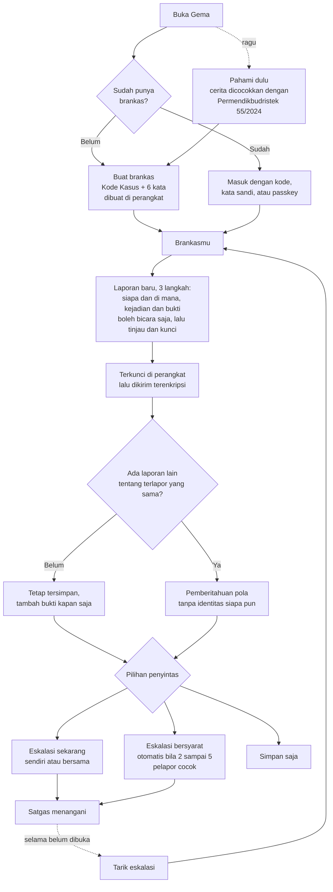
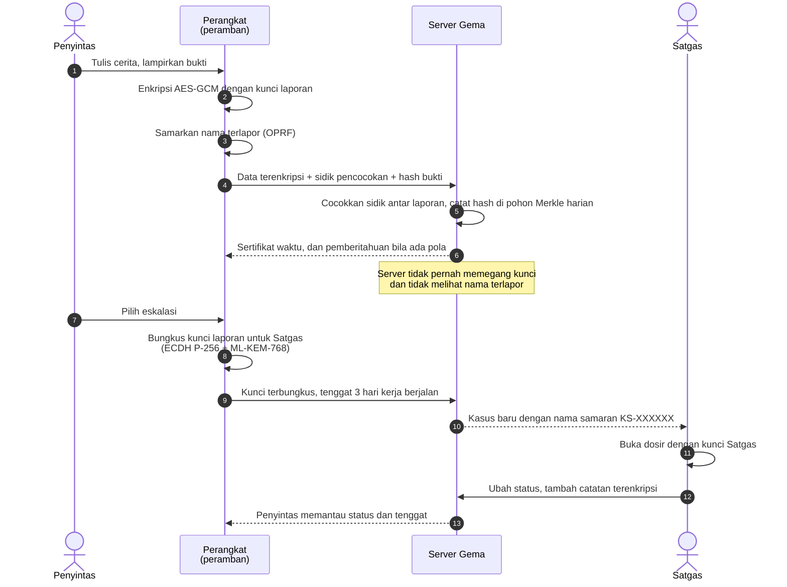
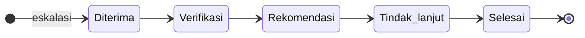

<div align="center">


# Ceritamu aman. Penanganannya terpantau.

**Platform web bagi penyintas kekerasan seksual di perguruan tinggi, dan bagi Satgas PPKPT yang menanganinya.**
Tanpa nama, email, atau telepon. Semua dikunci di perangkatmu.

<br />


[Pembeda](#yang-membedakan-gema) · [Alur kerja](#alur-kerja) · [Fitur](#fitur) · [Privasi](#cara-kerja-privasi) · [Mulai cepat](#mulai-cepat) · [Struktur](#struktur-proyek) · [Batas yang jujur](#batas-yang-jujur)

</div>

> [!WARNING]
> Gema masih prototipe dan belum diaudit pihak independen. Jangan dipakai untuk kasus nyata sebelum ditinjau ahli keamanan dan hukum.

## Kenapa Gema

Banyak penyintas tidak melapor karena takut identitasnya sampai ke pelaku yang berkuasa, ragu apakah pengalamannya termasuk kekerasan, atau khawatir buktinya hilang. Gema menjawab hambatan itu satu per satu.

| Hambatan                                 | Yang Gema lakukan                                                                                                                                          |
| ---------------------------------------- | ---------------------------------------------------------------------------------------------------------------------------------------------------------- |
| Takut identitas bocor                    | Brankas tanpa nama, email, atau telepon. Satgas baru tahu bila penyintas memilih eskalasi, dan eskalasi bisa ditarik selama Satgas belum membuka kasusnya. |
| Ragu apakah ini termasuk kekerasan       | **Pahami dulu**: cerita bebas dicocokkan dengan bentuk kekerasan di Permendikbudristek 55/2024, sebagai petunjuk, bukan putusan.                           |
| Bukti chat dihapus atau dibantah         | Sertifikat waktu berbasis pohon Merkle harian, Paket Bukti offline, dan penanda pesan penting pada ekspor WhatsApp.                                        |
| Merasa sendirian                         | Pencocokan pola terlapor tanpa membuka identitas siapa pun.                                                                                                |
| Bergantung secara akademik pada terlapor | Penanda relasi kuasa menandai kasus sebagai _Prioritas_ dan menyiapkan draf usulan pelindungan sementara.                                                  |
| Laporan didiamkan kampus                 | Tenggat hari kerja, tangga eskalasi T1 sampai T3, dan papan kepatuhan publik.                                                                              |
| Sulit mengetik saat tertekan             | **Bicara saja**: suara menjadi teks di perangkat.                                                                                                          |

## Yang membedakan Gema

Kanal pelaporan yang umum di kampus (formulir web, surel, atau pesan WhatsApp ke petugas) bertumpu pada kepercayaan kepada penerima. Gema memindahkan sebagian kepercayaan itu ke teknik yang bisa diperiksa. Perbandingan ini dengan jenis kanal tersebut, bukan ulasan produk tertentu.

| Kemampuan                   | Kanal umum                                | Gema                                                                                                           |
| --------------------------- | ----------------------------------------- | -------------------------------------------------------------------------------------------------------------- |
| Isi laporan                 | Terbaca oleh admin atau penerima          | Dienkripsi di perangkat pelapor. Server tidak memegang kunci pembukanya.                                       |
| Mengetahui ada korban lain  | Tidak ada, setiap laporan berdiri sendiri | **Pencocokan pola terlapor** lewat OPRF (RFC 9497), tanpa memberi nama terlapor kepada server.                 |
| Siapa yang memutuskan       | Penerima laporan                          | Pelapor memilih kapan eskalasi, termasuk **eskalasi bersyarat** (baru terkirim bila 2 sampai 5 pelapor cocok). |
| Kampus menunda              | Tidak terlihat dari luar                  | **Tenggat 3 hari kerja**, tangga eskalasi T1 sampai T3, dan **Papan Kepatuhan** publik.                        |
| Bukti dihapus atau dibantah | Tangkapan layar tanpa jejak waktu         | **Sertifikat waktu** pohon Merkle harian, dan **verifikasi mandiri** tanpa akun.                               |
| Penyalahgunaan oleh Satgas  | Bergantung pada kepercayaan               | **Empat Mata** (kunci terpecah 2-dari-3, ditambah persetujuan anggota lain) dan **jejak audit** berantai hash. |
| Paksaan di sekitar pelapor  | Tidak ada                                 | **Kode Paksa** membuka brankas tiruan. **Pemulihan** lewat tiga orang tepercaya bila lupa sandi.               |
| Sulit menulis saat tertekan | Formulir panjang                          | **Bicara saja** (suara jadi teks di perangkat) dan pendamping yang tidak mengirim cerita ke layanan AI.        |

Tiga hal yang paling sulit ditiru:

1. **Pencocokan tanpa membuka nama.** Pola pelaku berulang terlihat tanpa ada pihak yang menyimpan daftar nama terlapor.
2. **Satgas ikut dibatasi.** Membuka isi laporan perlu dua orang, dan setiap pembukaan tercatat.
3. **Kampus bisa dipantau.** Tenggat dan kepatuhan terlihat publik, bukan janji di atas kertas.

Batasnya: semua ini prototipe yang belum diaudit pihak independen (lihat [Batas yang jujur](#batas-yang-jujur)), dan brankas tanpa nama bukan jaminan anonimitas.

## Alur kerja

Gema punya tiga pihak: **penyintas** yang menyimpan bukti, **Satgas** kampus yang menangani, dan **publik** yang bisa memeriksa bukti serta ketepatan waktu penanganan. Server di tengah hanya memegang data terkunci.

### 1. Perjalanan penyintas



Beberapa hal yang sengaja dibuat begitu:

- **Draf tersimpan terenkripsi di perangkat** tiap 10 detik, jadi pelapor boleh berhenti kapan saja. Isi berkas bukti perlu dipilih ulang saat lanjut.
- **Keluar cepat** tersedia di setiap halaman (juga lewat Esc dua kali): menghapus draf dan sesi di perangkat lalu membuka situs netral.
- **Kode Paksa** membuka brankas tiruan bila pelapor dipaksa membuka brankasnya.
- **Catatan penanganan**: setelah kasus dikirim, pelapor dapat mengunduh kronologi (kirim, tenggat, status, keterlambatan, waktu Satgas membuka kasus, hash bukti) sebagai satu berkas HTML untuk dibawa ke pihak luar bila Satgas tidak bergerak. Dibuat di perangkat, tanpa nama atau isi laporan.
- **Kapan dan Di mana wajib diisi, tetapi boleh kira-kira.** Kapan dipilih dari kalender (atau hanya bulan bila tanggal pastinya terlupa) dan tidak boleh di masa depan. Periode kejadian berupa pilihan semester, bukan ketikan, agar nilainya baku dan bisa dicocokkan antar-laporan.

### 2. Dari penyimpanan sampai eskalasi



### 3. Penanganan oleh Satgas

Setiap kasus melewati lima status, dan hanya boleh maju satu langkah (Tindak_lanjut berarti tindak lanjut pimpinan). Tenggatnya 3 hari kerja (Permendikbudristek 55/2024 Pasal 53). Bila terlewat, tangga eskalasi naik sendiri dan tercatat di jejak audit. Kalau tenggat terlewat, naik ke T1 Ketua Satgas; lalu T2 Pimpinan (terlambat 3 hari kerja); lalu T3 kementerian, hanya agregat (10 hari kerja). Ambang T2 dan T3 adalah nilai bawaan dan bisa diatur. Kenaikan tangga tercatat di aplikasi; bila SMTP diatur, penerima tingkatnya juga mendapat surel tanpa isi kasus. Penjadwal harian yang menaikkan tangga dipantau: Ketua dan Auditor melihat peringatan bila penjadwal mati lebih dari dua hari.



| Peran    | Yang bisa dilakukan                                                                                     |
| -------- | ------------------------------------------------------------------------------------------------------- |
| Ketua    | Membaca dosir, memajukan dan menutup kasus, menugaskan penanggung jawab, mengelola kunci dan Empat Mata |
| Anggota  | Membaca dosir, menulis catatan terenkripsi, memajukan status sampai Tindak lanjut pimpinan              |
| Pimpinan | Melihat daftar kasus dan radar pola per unit, menandai kasus selesai                                    |
| Auditor  | Memeriksa jejak audit berantai hash                                                                     |
| Pengawas | Melihat angka agregat tingkat 3, tanpa isi kasus                                                        |

Dengan mode **Empat Mata**, dosir hanya terbuka bila anggota lain menyetujui permintaan pembukaan (berlaku 30 menit), dan kunci Satgas dipecah 2-dari-3 sehingga satu orang tidak bisa membukanya sendirian. Mengaktifkannya butuh minimal dua akun panel, dan mematikannya butuh persetujuan anggota panel lain.

Anggota panel yang punya **konflik kepentingan** dapat **mundur** dari satu kasus. Setelah itu ia tidak bisa membuka, menindak, atau menyetujui akses kasus itu, penugasannya lepas, dan kejadiannya tercatat di jejak audit serta terlihat oleh pelapor tanpa nama dan tanpa alasan.

### 4. Yang bisa dilihat siapa saja

- **Periksa bukti** (`/verifikasi`): unggah berkas dan Paket Bukti, lalu cek apakah berkas masih utuh sejak waktu pengunggahan. Tanpa akun, bahkan bisa offline lewat berkas HTML mandiri.
- **Papan Kepatuhan** (`/papan`): persentase ketepatan waktu UPN Veteran Jawa Timur per kuartal. Angkanya diberi derau privasi diferensial supaya satu kasus tidak bisa ditebak.
- **Coba demo** (`/demo`): masuk sebagai pelapor atau sebagai peran Satgas dengan satu klik, memakai data contoh fiktif yang diberi label "Mode demo". Email dan kata sandi akun Satgas demo ditampilkan di `/demo` dan di halaman masuk Satgas, supaya jalur masuk yang sama dengan akun sungguhan bisa dicoba.

## Fitur

<table>
<tr>
<td width="33%" valign="top">

**Untuk penyintas**

- Brankas terenkripsi di perangkat
- Kode Kasus dan kata sandi enam kata
- Kode Paksa (brankas tiruan)
- Passkey (WebAuthn PRF) dan pemulihan lewat tiga orang tepercaya
- Bicara saja: suara jadi teks di perangkat
- Eskalasi, eskalasi bersyarat, dan penarikan
- Catatan penanganan untuk dibawa ke pihak luar
- Melihat kapan Satgas membuka kasusnya

</td>
<td width="33%" valign="top">

**Untuk Satgas**

- Daftar kasus dengan tenggat dan label Prioritas
- Penugasan penanggung jawab
- Mode Empat Mata dengan kunci terpecah
- Mundur karena konflik kepentingan
- Peringatan bila penjadwal harian mati
- Surel tangga eskalasi (opsional)
- Bukti Pemilik nol-pengetahuan
- Jejak audit berantai hash
- Radar pola berderau dan direktori rujukan

</td>
<td width="33%" valign="top">

**Untuk semua orang**

- Verifikasi bukti mandiri
- Papan Kepatuhan publik
- Pendamping di peramban, tanpa layanan AI
- Penanda pesan penting pada ekspor WhatsApp
- Bantuan segera: SAPA 129, Komnas Perempuan, LPSK

</td>
</tr>
</table>

## Cara kerja privasi

```
Perangkat pelapor                         Server Gema
─────────────────                         ───────────
cerita + bukti ──enkripsi AES-GCM──▶      hanya menerima data terenkripsi
kunci brankas  (tidak pernah dikirim)     tidak memegang kunci apa pun
sidik pencocokan ──OPRF──▶                mencocokkan tanpa melihat nama
sertifikat waktu ◀── akar Merkle harian ──┘  diarsipkan ke repositori publik
```

- Kripto: AES-GCM, PBKDF2, HKDF, ECDH P-256 + ML-KEM-768 (hibrida), OPRF RFC 9497, pohon Merkle RFC 6962, Shamir GF(256), bukti Schnorr.
- CSP berbasis nonce per permintaan, tanpa `unsafe-inline` untuk skrip.
- Sesi pelapor dikunci setelah 5 menit tanpa aktivitas; isi laporan tersamar sampai dibuka.

## Mulai cepat

Prasyarat: Node.js 22 atau lebih baru.

```bash
npm install     # bila unduhan biner onnxruntime-node gagal: npm install --ignore-scripts
npm run dev     # http://localhost:3000
```

Buka `/demo` untuk mencoba semua peran. Selama Mode Demo aktif (bawaan di pengembangan), basis data baru berisi data contoh fiktif: tiga pelapor, beberapa kasus, dan angka kepatuhan. Data tersimpan di `.data/`; hapus folder itu dan jalankan ulang untuk memulai dari awal. Jalankan dengan `GEMA_SEED_CONTOH=off` untuk basis data kosong. Di produksi, demo hanya menyala bila `GEMA_DEMO=on`, dan instans demo tidak boleh dipakai untuk cerita nyata. Untuk dipakai sungguhan tanpa unsur demo, lihat [Mode sungguhan](docs/panduan/DEPLOY.md#mode-sungguhan-tanpa-demo): akun admin dibuat dari `GEMA_SATGAS_AKUN`, dan eskalasi menunggu Ketua membuat kunci sendiri.

<details>
<summary><b>Perintah yang tersedia</b></summary>

<br />

| Perintah            | Fungsi                                                              |
| ------------------- | ------------------------------------------------------------------- |
| `npm run check`     | Semua pemeriksaan sekaligus: tipe, ESLint, Stylelint, Prettier, tes |
| `npm test`          | Vitest: kripto, OPRF, KEM, Merkle, parser, API, Postgres            |
| `npm run typecheck` | `tsc --noEmit` dengan `noUnusedLocals` dan `noUnusedParameters`     |
| `npm run lint`      | ESLint                                                              |
| `npm run lint:css`  | Stylelint untuk `src/styles/*.css`                                  |
| `npm run format`    | Prettier menulis ulang berkas                                       |

</details>

## Struktur proyek

<details>
<summary><b>Peta folder</b></summary>

<br />

```
gema/
├─ src/
│  ├─ app/             halaman dan rute API (Next.js App Router)
│  ├─ components/      komponen UI
│  ├─ lib/             logika sisi klien
│  │  ├─ vault/        brankas, kunci, passkey, pemulihan, bukti pemilik
│  │  ├─ laporan/      penyusunan laporan, format, draf terenkripsi
│  │  ├─ asr/          dikte suara di perangkat
│  │  ├─ ui/           format tampilan, keluar cepat, rujukan
│  │  └─ demo/         akun dan kunci Mode Demo
│  ├─ server/
│  │  ├─ routes/       rute API per domain: publik, akun, pelapor, satgas, demo, cron
│  │  ├─ logic/        aturan inti: sesi, akun, laporan, klaster, eskalasi, SLA, anchor
│  │  ├─ seed/         institusi, unit, dan akun peran Mode Demo (data contoh fiktif ikut dimuat saat Mode Demo aktif; matikan dengan GEMA_SEED_CONTOH=off)
│  │  └─ backends/     penyimpanan berkas dan PostgreSQL
│  ├─ styles/          CSS berlapis, urutan impor di layout.tsx menentukan cascade
│  └─ proxy.ts         CSP nonce
├─ packages/           pustaka tanpa dependensi UI
│  ├─ crypto  oprf  pq-kem  merkle  zk  shamir
│  └─ matching  chat-parser  pendamping  dp  passphrase
├─ tests/
│  ├─ e2e/             uji alur API dari laporan sampai pertanggungjawaban
│  └─ unit/            uji fungsi murni dan penjaga (CSS, bentuk kekerasan, vektor ML-KEM)
├─ scripts/            pembangun Verifier Mandiri, penyalin runtime WASM
├─ docs/               panduan, catatan desain, arsip
└─ public/             logo, gambar, runtime WASM
```

</details>

## Dokumentasi

| Dokumen                                                                      | Isi                                          |
| ---------------------------------------------------------------------------- | -------------------------------------------- |
| [`docs/ARSITEKTUR.md`](docs/ARSITEKTUR.md)                                   | Peta kode, alur data, dan kebiasaan kode     |
| [`docs/KONTRIBUSI.md`](docs/KONTRIBUSI.md)                                   | Cara menambah endpoint, halaman, dan gaya    |
| [`docs/desain/CSS.md`](docs/desain/CSS.md)                                   | Peta CSS dan aturan menambah gaya            |
| [`docs/desain/PENYEMPURNAAN-VISUAL.md`](docs/desain/PENYEMPURNAAN-VISUAL.md) | Keputusan visual, pengukuran, dan batasannya |
| [`docs/desain/AUDIT-UI.md`](docs/desain/AUDIT-UI.md)                         | Audit antarmuka dan aksesibilitas            |
| [`docs/desain/KREDIT-FOTO.md`](docs/desain/KREDIT-FOTO.md)                   | Kredit foto latar                            |

## Keberlanjutan

Gema dirancang agar tetap berguna setelah lomba: dipakai kampus, bukan sekadar didemokan.

| Segi        | Wujudnya di Gema                                                                                                                                 |
| ----------- | ------------------------------------------------------------------------------------------------------------------------------------------------ |
| Sosial      | Menurunkan hambatan melapor kekerasan seksual di kampus. Sejalan dengan SDG 5 (kesetaraan gender), SDG 16 (institusi yang akuntabel), dan SDG 4. |
| Kelembagaan | Tenggat tindak lanjut 3 hari kerja dan jejak yang dapat diperiksa mengikuti Permendikbudristek 55/2024, jadi selaras dengan kewajiban Satgas.    |
| Teknis      | Dijalankan sendiri oleh kampus, memakai standar terbuka (RFC 9497, RFC 9162), tanpa API AI berbayar. Pendamping bekerja di perangkat pengguna.   |
| Kepercayaan | Server tidak memegang kunci pembuka isi, sehingga kepercayaan tidak bergantung pada satu admin.                                                  |

Yang belum diukur: jejak energi atau karbon, dan kinerja di bawah beban banyak pengguna. Penyimpanan saat ini hanya cocok untuk satu instans server (lihat batas di bawah).

## Batas yang jujur

- Kripto memakai pustaka `@noble/*` yang belum diaudit formal untuk proyek ini. ML-KEM-768 lulus 60 vektor resmi NIST ACVP dan OPRF lulus vektor RFC 9497.
- Fitur lanjutan (Empat Mata, Bukti Pemilik, passkey, pemulihan) belum ditinjau pihak independen. Passkey diuji dengan autentikator virtual, bukan perangkat keras.
- Brankas tanpa nama bukan jaminan anonimitas: isi cerita dan jaringan tetap dapat mengungkap identitas.
- Aksesibilitas diuji otomatis (axe-core) dan dengan keyboard di emulasi peramban. Pembaca layar sungguhan (NVDA, TalkBack, VoiceOver) dan pengguna nyata belum diuji.
- Pendamping berbasis kata, bukan model bahasa besar, dan selalu menyebut hasilnya "petunjuk, bukan keputusan hukum". Akurasi suara pada ucapan manusia belum diukur.
- Nomor layanan rujukan perlu diperiksa ulang sebelum peluncuran.
- Penyimpanan hanya cocok untuk satu instans server.
- Gema membuat kasus yang dipendam terdeteksi dan terdokumentasi, bukan mencegah suap atau kolusi: dua anggota panel yang bersekongkol menembus Empat Mata, dan mundur bergantung pada kejujuran anggota. Eskalasi tercatat di dalam aplikasi; tidak ada jalur otomatis ke kementerian.
- Catatan penanganan disusun dari data aplikasi, bukan dokumen resmi kampus, dan tidak membuktikan isi laporan benar.
- Belum diuji di perangkat nyata (passkey, Safari), oleh pengguna awam, atau oleh penguji penetrasi independen.
- Keluar cepat menghapus draf dan sesi di perangkat ini, tetapi tidak menghapus riwayat peramban.

## Lisensi

MIT.
