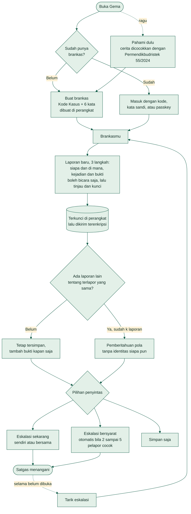
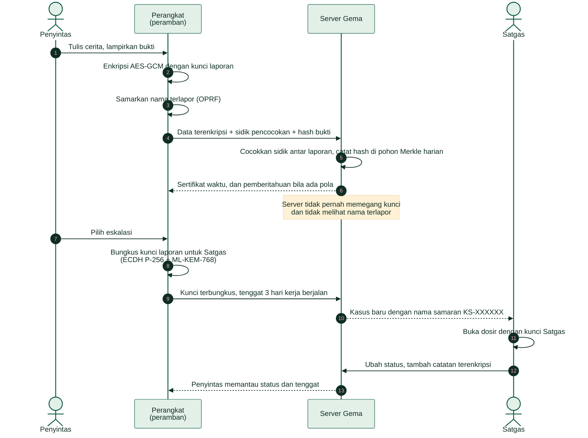
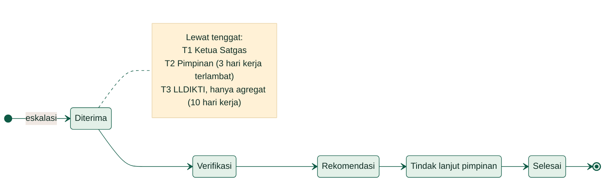

<div align="center">


# Simpan bukti dulu. Putuskan melapor nanti.

**Platform web bagi penyintas kekerasan seksual di perguruan tinggi, dan bagi Satgas PPKPT yang menanganinya.**
Tanpa nama, email, atau telepon. Semua dikunci di perangkatmu.

<br />


[Alur kerja](#alur-kerja) · [Fitur](#fitur) · [Privasi](#cara-kerja-privasi) · [Mulai cepat](#mulai-cepat) · [Struktur](#struktur-proyek) · [Batas yang jujur](#batas-yang-jujur)

</div>

> [!WARNING]
> Gema masih prototipe dan belum diaudit pihak independen. Jangan dipakai untuk kasus nyata sebelum ditinjau ahli keamanan dan hukum.

## Kenapa Gema

Banyak penyintas tidak melapor karena takut identitasnya sampai ke pelaku yang berkuasa, ragu apakah pengalamannya termasuk kekerasan, atau khawatir buktinya hilang. Gema menjawab hambatan itu satu per satu.

| Hambatan                                 | Yang Gema lakukan                                                                                                                                          |
| ---------------------------------------- | ---------------------------------------------------------------------------------------------------------------------------------------------------------- |
| Takut identitas bocor                    | Brankas tanpa nama, email, atau telepon. Satgas baru tahu bila penyintas memilih eskalasi, dan eskalasi bisa ditarik selama Satgas belum membuka kasusnya. |
| Ragu apakah ini termasuk kekerasan       | **Pahami dulu**: cerita bebas dicocokkan dengan bentuk kekerasan di Permendikbudristek 55/2024, sebagai petunjuk, bukan putusan.                           |
| Bukti chat dihapus atau dibantah         | Sertifikat waktu berbasis pohon Merkle harian, Paket Bukti offline, dan penanda pesan penting pada ekspor WhatsApp.                                        |
| Merasa sendirian                         | Pencocokan pola terlapor tanpa membuka identitas siapa pun.                                                                                                |
| Bergantung secara akademik pada terlapor | Penanda relasi kuasa menandai kasus sebagai _Prioritas_ dan menyiapkan draf usulan pelindungan sementara.                                                  |
| Laporan didiamkan kampus                 | Tenggat hari kerja, tangga eskalasi T1 sampai T3, dan papan kepatuhan publik.                                                                              |
| Sulit mengetik saat tertekan             | **Bicara saja**: suara menjadi teks di perangkat.                                                                                                          |

## Alur kerja

Gema punya tiga pihak: **penyintas** yang menyimpan bukti, **Satgas** kampus yang menangani, dan **publik** yang bisa memeriksa bukti serta ketepatan waktu penanganan. Server di tengah hanya memegang data terkunci.

### 1. Perjalanan penyintas



Beberapa hal yang sengaja dibuat begitu:

- **Draf tersimpan terenkripsi di perangkat** tiap 10 detik, jadi pelapor boleh berhenti kapan saja. Isi berkas bukti perlu dipilih ulang saat lanjut.
- **Keluar cepat** tersedia di setiap halaman (juga lewat Esc dua kali): menghapus draf dan sesi di perangkat lalu membuka situs netral.
- **Kode Paksa** membuka brankas tiruan bila pelapor dipaksa membuka brankasnya.

### 2. Dari penyimpanan sampai eskalasi



### 3. Penanganan oleh Satgas

Setiap kasus melewati lima status, dan hanya boleh maju satu langkah. Tenggatnya 3 hari kerja (Permendikbudristek 55/2024 Pasal 53). Bila terlewat, tangga eskalasi naik sendiri dan tercatat di jejak audit. Ambang T2 dan T3 di bawah adalah nilai bawaan dan bisa diatur per kampus.



| Peran    | Yang bisa dilakukan                                                                                     |
| -------- | ------------------------------------------------------------------------------------------------------- |
| Ketua    | Membaca dosir, memajukan dan menutup kasus, menugaskan penanggung jawab, mengelola kunci dan Empat Mata |
| Anggota  | Membaca dosir, menulis catatan terenkripsi, memajukan status sampai Tindak lanjut pimpinan              |
| Pimpinan | Melihat daftar kasus dan radar pola per unit, menandai kasus selesai                                    |
| Auditor  | Memeriksa jejak audit berantai hash                                                                     |
| Pengawas | Melihat angka agregat tingkat 3, tanpa isi kasus                                                        |

Dengan mode **Empat Mata**, dosir hanya terbuka bila anggota lain menyetujui permintaan pembukaan (berlaku 30 menit), dan kunci Satgas dipecah 2-dari-3 sehingga satu orang tidak bisa membukanya sendirian.

### 4. Yang bisa dilihat siapa saja

- **Periksa bukti** (`/verifikasi`): unggah berkas dan Paket Bukti, lalu cek apakah berkas masih utuh sejak waktu pengunggahan. Tanpa akun, bahkan bisa offline lewat berkas HTML mandiri.
- **Papan Kepatuhan** (`/papan`): persentase ketepatan waktu tiap kampus per kuartal. Angkanya diberi derau privasi diferensial supaya satu kasus tidak bisa ditebak.
- **Coba demo** (`/demo`): semua peran dengan data fiktif, dalam sekitar lima menit.

## Fitur

<table>
<tr>
<td width="33%" valign="top">

**Untuk penyintas**

- Brankas terenkripsi di perangkat
- Kode Kasus dan kata sandi enam kata
- Kode Paksa (brankas tiruan)
- Passkey (WebAuthn PRF) dan pemulihan lewat tiga orang tepercaya
- Bicara saja: suara jadi teks di perangkat
- Eskalasi, eskalasi bersyarat, dan penarikan

</td>
<td width="33%" valign="top">

**Untuk Satgas**

- Daftar kasus dengan tenggat dan label Prioritas
- Penugasan penanggung jawab
- Mode Empat Mata dengan kunci terpecah
- Bukti Pemilik nol-pengetahuan
- Jejak audit berantai hash
- Radar pola berderau dan direktori rujukan

</td>
<td width="33%" valign="top">

**Untuk semua orang**

- Verifikasi bukti mandiri
- Papan Kepatuhan publik
- Pendamping di peramban, tanpa layanan AI
- Penanda pesan penting pada ekspor WhatsApp
- Bantuan segera: SAPA 129, Komnas Perempuan, LPSK

</td>
</tr>
</table>

## Cara kerja privasi

```
Perangkat pelapor                         Server Gema
─────────────────                         ───────────
cerita + bukti ──enkripsi AES-GCM──▶      hanya menerima data terenkripsi
kunci brankas  (tidak pernah dikirim)     tidak memegang kunci apa pun
sidik pencocokan ──OPRF──▶                mencocokkan tanpa melihat nama
sertifikat waktu ◀── akar Merkle harian ──┘  diarsipkan ke repositori publik
```

- Kripto: AES-GCM, PBKDF2, HKDF, ECDH P-256 + ML-KEM-768 (hibrida), OPRF RFC 9497, pohon Merkle RFC 6962, Shamir GF(256), bukti Schnorr.
- CSP berbasis nonce per permintaan, tanpa `unsafe-inline` untuk skrip.
- Sesi pelapor dikunci setelah 5 menit tanpa aktivitas; isi laporan tersamar sampai dibuka.

## Mulai cepat

Prasyarat: Node.js 22 atau lebih baru.

```bash
npm install     # bila unduhan biner onnxruntime-node gagal: npm install --ignore-scripts
npm run dev     # http://localhost:3000
```

Buka `/demo` untuk mencoba semua peran dengan data fiktif. Data tersimpan di `.data/`.

<details>
<summary><b>Perintah yang tersedia</b></summary>

<br />

| Perintah            | Fungsi                                                              |
| ------------------- | ------------------------------------------------------------------- |
| `npm run check`     | Semua pemeriksaan sekaligus: tipe, ESLint, Stylelint, Prettier, tes |
| `npm test`          | Vitest: kripto, OPRF, KEM, Merkle, parser, API, Postgres            |
| `npm run typecheck` | `tsc --noEmit` dengan `noUnusedLocals` dan `noUnusedParameters`     |
| `npm run lint`      | ESLint                                                              |
| `npm run lint:css`  | Stylelint untuk `src/styles/*.css`                                  |
| `npm run format`    | Prettier menulis ulang berkas                                       |

</details>

## Struktur proyek

<details>
<summary><b>Peta folder</b></summary>

<br />

```
gema/
├─ src/
│  ├─ app/             halaman dan rute API (Next.js App Router)
│  ├─ components/      komponen UI
│  ├─ lib/             logika klien: brankas, bukti, passkey, format
│  ├─ server/
│  │  ├─ routes/       rute API per domain: publik, akun, pelapor, satgas, demo, cron
│  │  ├─ logic/        aturan inti: sesi, akun, laporan, klaster, eskalasi, SLA, anchor
│  │  ├─ seed/         data fiktif Mode Demo
│  │  └─ backends/     penyimpanan berkas dan PostgreSQL
│  ├─ styles/          CSS berlapis, urutan impor di layout.tsx menentukan cascade
│  └─ proxy.ts         CSP nonce
├─ packages/           pustaka tanpa dependensi UI
│  ├─ crypto  oprf  pq-kem  merkle  zk  shamir
│  └─ matching  chat-parser  pendamping  dp  passphrase
├─ tests/              uji unit, API end-to-end, dan klaim teks
├─ scripts/            pembangun Verifier Mandiri, penyalin runtime WASM
├─ docs/               panduan, catatan desain, arsip
└─ public/             logo, gambar, runtime WASM
```

</details>

## Dokumentasi

| Dokumen                                                                      | Isi                                          |
| ---------------------------------------------------------------------------- | -------------------------------------------- |
| [`docs/panduan/NASKAH-DEMO.md`](docs/panduan/NASKAH-DEMO.md)                 | Alur demo lima menit                         |
| [`docs/desain/PENYEMPURNAAN-VISUAL.md`](docs/desain/PENYEMPURNAAN-VISUAL.md) | Keputusan visual, pengukuran, dan batasannya |
| [`docs/desain/AUDIT-UI.md`](docs/desain/AUDIT-UI.md)                         | Audit antarmuka dan aksesibilitas            |
| [`docs/desain/KREDIT-FOTO.md`](docs/desain/KREDIT-FOTO.md)                   | Kredit foto latar                            |

## Batas yang jujur

- Kripto memakai pustaka `@noble/*` yang belum diaudit formal untuk proyek ini. ML-KEM-768 lulus 60 vektor resmi NIST ACVP dan OPRF lulus vektor RFC 9497.
- Fitur lanjutan (Empat Mata, Bukti Pemilik, passkey, pemulihan) belum ditinjau pihak independen. Passkey diuji dengan autentikator virtual, bukan perangkat keras.
- Brankas tanpa nama bukan jaminan anonimitas: isi cerita dan jaringan tetap dapat mengungkap identitas.
- Aksesibilitas diuji otomatis (axe-core) dan dengan keyboard di emulasi peramban. Pembaca layar sungguhan (NVDA, TalkBack, VoiceOver) dan pengguna nyata belum diuji.
- Pendamping berbasis kata, bukan model bahasa besar, dan selalu menyebut hasilnya "petunjuk, bukan keputusan hukum". Akurasi suara pada ucapan manusia belum diukur.
- Nomor layanan rujukan perlu diperiksa ulang sebelum peluncuran.
- Penyimpanan hanya cocok untuk satu instans server.
- Keluar cepat menghapus draf dan sesi di perangkat ini, tetapi tidak menghapus riwayat peramban.

## Lisensi

MIT.
